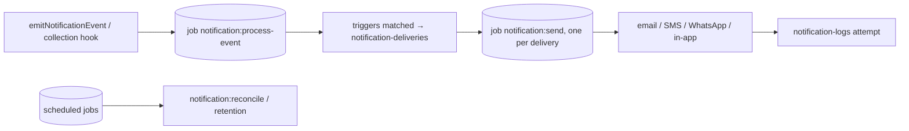

# Deployment and job processing

Notifications are processed by Payload's jobs queue, which defaults to the `notifications` queue (`jobs.queue` changes it). Nothing is sent unless something runs that queue.

## How processing works



- **Emitting:** queues `notification:process-event`. Inside a hook or transaction, pass `req` so the job only exists if the write commits.
- **Processing** plans deliveries and queues one `notification:send` job per delivery. Scheduled deliveries use the job's `waitUntil`, and so do retries (with backoff).
- **Sending** is idempotent: a delivery that is already final is never sent again, and retries reuse the same delivery record.

## Choose how the queue runs

### Long-running server (Node, containers, VMs)

```ts
export default buildConfig({
  jobs: {
    autoRun: [{ cron: '* * * * *', queue: 'notifications', limit: 50 }],
    // Payload 3 with several workers: one send per delivery at a time (needs a migration).
    enableConcurrencyControl: true,
  },
})
```

`autoRun` runs inside the web process. For a busy app, run the queue from a separate worker with the same config, and disable `autoRun` in the web process:

```bash
# Payload 3: keeps running on the cron schedule
bunx payload jobs:run --queue notifications --cron "* * * * *"
# Payload 4: runs once (call it from your scheduler; --handle-schedules also queues due scheduled tasks)
bunx payload jobs:run --queue notifications --handle-schedules
```

### Serverless (Vercel, Netlify, …)

Functions don't stay alive, so call Payload's run endpoint on a schedule:

```
GET /api/payload-jobs/run?queue=notifications&limit=50
```

Protect it with `jobs.access.run`, for example with a cron secret:

```ts
jobs: {
  access: {
    run: ({ req }) =>
      Boolean(req.user) || req.headers.get('authorization') === `Bearer ${process.env.CRON_SECRET}`,
  },
}
```

- **Vercel:** a `vercel.json` cron (`"schedule": "* * * * *"`) calls the path; Vercel sends `Authorization: Bearer $CRON_SECRET`.
- **Frequency:** a one-minute cron means scheduled sends and retries run within about a minute of their time.

### Cloudflare Workers (D1, R2)

Use a Cron Trigger and run the queue in the Worker's `scheduled` handler:

```jsonc
// wrangler.jsonc
{ "triggers": { "crons": ["* * * * *"] } }
```

```ts
export default {
  fetch: app.fetch,
  async scheduled(_event, env, ctx) {
    const payload = await getPayload({ config })
    ctx.waitUntil(payload.jobs.run({ queue: 'notifications', limit: 50, overrideAccess: true }))
  },
}
```

- **D1:** IDs are numeric. The plugin converts relationship IDs for you; this is covered by the SQLite integration tests.
- **Migrations:** run them as part of your deploy (`payload migrate`, or apply the generated SQL with `wrangler d1 migrations apply`).
- **Secrets:** keep provider secrets in Worker secrets (`wrangler secret put TWILIO_AUTH_TOKEN`) and read them from `env` / `process.env` in the config.

### Maintenance jobs

```ts
notificationsPlugin({
  maintenance: {
    reconcileCron: '*/15 * * * *', // stuck "sending" → "unknown"; provider status lookups
    retentionCron: '0 3 * * *',
    retention: { logsDays: 90, deliveriesDays: 180, eventsDays: 30 },
  },
})
```

These are scheduled Payload tasks. `autoRun` handles schedules for you. With a serverless cron or a CLI worker, also queue due schedules: call `GET /api/payload-jobs/handle-schedules` before `/run`, or use the `jobs:handle-schedules` CLI (Payload 4: `jobs:run --handle-schedules`).

## Provider webhooks

Delivery status and STOP replies arrive through webhooks. Set `webhooks.publicUrl` (or `serverURL`) and point the providers at:

| Provider | URL | Verification |
|---|---|---|
| Twilio SMS / WhatsApp | `/api/payload-notifications/webhooks/twilio` | `webhooks.twilio.authToken` (signature) |
| Meta WhatsApp | `/api/payload-notifications/webhooks/meta` | `webhooks.meta.appSecret`, `verifyToken` |
| Custom provider | `/api/payload-notifications/webhooks/provider/<channel>` | the provider's `parseWebhook` |

**Providers & settings** on the admin dashboard shows the exact URLs and whether signatures are configured. See [providers.md](./providers.md) and [reliability.md](./reliability.md#webhooks).

## Production checklist

- [ ] A job runner drains the `notifications` queue (and handles schedules if you use maintenance crons).
- [ ] Database migrations are applied (SQL adapters).
- [ ] Provider secrets come from environment variables. **Test connection** passes on the dashboard.
- [ ] `access.*` checks use real roles ([operations-admin.md](./operations-admin.md#permissions)).
- [ ] `webhooks.*` secrets are set, so webhook signatures are verified.
- [ ] `preferences.unsubscribe.secret` is set if marketing emails are sent.
- [ ] Email adapter configured: the console adapter only logs.
- [ ] `observability.onEvent` is connected to your logs or metrics.

## Troubleshooting: nothing is sent

| Symptom | Check |
|---|---|
| No `notification-deliveries` rows | Is a job runner processing `notification:process-event`? Does a trigger match the event name and its conditions? With `eventsInbox`, look at the event's status and `matched`. |
| Deliveries stay `queued` | The runner isn't processing `notification:send`, or `waitUntil` is in the future (scheduled, retry backoff or quiet hours). Check `scheduledFor` / `nextAttemptAt`. |
| Deliveries `skipped` | `skipReason`: no destination, opted out, suppressed, missing consent, dedupe. |
| Deliveries `failed` / `unknown` | Open the delivery: the attempts show provider errors. Retry from the inspector. |
| Jobs fail with "concurrency controls" (Payload 3) | Set `jobs.enableConcurrencyControl: true` and migrate, or leave it off: the plugin then skips concurrency keys. |
| Webhooks return 401 | Signature secret mismatch, or `publicUrl` differs from the URL the provider calls (Twilio signs the exact URL). |

## Coming from 0.1.x / 0.2.x

Apps that patched deferred send handlers by hand, or called handlers outside the jobs queue, can remove that code:
- The plugin registers its tasks, and its handlers are wired on `onInit`.
- Use `emitNotificationEvent`, and run the queue as described above.

See [migration.md](./migration.md) for 0.3.x → 1.0.
