# End-to-end expectations

Happy path for dynamic, admin-editable notifications:

```mermaid
flowchart LR
  seed[Seed or create template] --> activate[status active]
  activate --> rule[Add plugin rule]
  rule --> emit[emitNotificationEvent]
  emit --> process[notification:process-event]
  process --> deliveries[notification-deliveries]
  deliveries --> send[notification:send per delivery]
  send --> channel[email / sms / whatsapp / inapp]
  channel --> logs[notification-logs]
```

## Checklist

1. **Install plugin** and configure `channels` + providers ([getting-started.md](./getting-started.md))  
2. **Seed** starters (`templates.seedOnInit` or `seedTemplatesFromRegistry`) ([seeding.md](./seeding.md))  
3. **Edit** templates in admin; use **Preview** / **Send test** ([admin-templates.md](./admin-templates.md))  
4. Set template `status` to **`active`**  
5. **Register a trigger** (or legacy rule) for your event, recipients, channels and template slug ([triggers.md](./triggers.md))  
6. From a domain action, **`emitNotificationEvent`** with `userId`, `classification`, `idempotencyKey`, payload  
7. Ensure the **`notifications` jobs queue** is drained ([jobs-and-operations.md](./jobs-and-operations.md))  
8. Verify **`notification-deliveries`**, **`notification-logs`** and (for in-app) **`notifications`**  
9. Optionally hook **`observability.onDispatch`** and preferences/policy ([preferences-and-policy.md](./preferences-and-policy.md), [observability.md](./observability.md))  

## Dynamic content expectations

| Layer | Dynamic? |
|-------|----------|
| Template body in DB | Yes — admin editable without deploy |
| Tokens / conditionals | Yes — engine at send time |
| Channels and recipients | Yes — triggers (code or admin-created) |
| Recipient prefs / marketing | Yes — user fields + policy |
| Retries | Yes — per-delivery retry policy, fallbacks, admin retry |

## Worked examples

See [examples.md](./examples.md) for complete e-commerce and booking workflows (tested on a real Payload instance).

## Not included yet

- Campaigns, scheduled blasts and A/B tests
- Automatic open and click tracking
